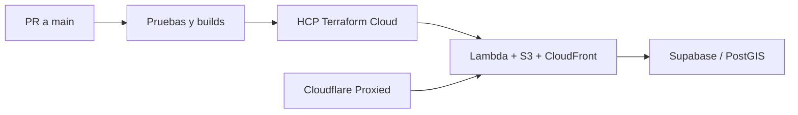

<div align="center">


# Chapa Tu Choro

**El Perú, con perspectiva.**

Explora denuncias registradas, tendencias históricas y contexto poblacional con datos oficiales.

**React · TypeScript · MapLibre · ASP.NET Core 10 · PostgreSQL/PostGIS · Python**

[Inicio local](#ejecutar-localmente) · [Roadmap de despliegue](docs/setup-roadmap.md) · [Arquitectura](docs/architecture.md) · [Metodología](docs/methodology.md)

</div>

---

## Qué puedes explorar

| Vista | Funcionalidades |
| --- | --- |
| **Mapa** | Navegación por Perú, departamento, provincia y distrito; filtros por período y categoría; coropletas, rankings y detalle territorial |
| **Concentración** | Agregados geográficos, consulta por radio y controles de capas, con límites de interpretación explícitos |
| **Tendencias** | Series mensuales, categorías, gráficos de líneas/barras/distribución y período compartido |
| **Población y comparación** | Tasas por 100.000 habitantes, historia territorial, medias móviles, referencias históricas/estacionales y tasa nacional ponderada |
| **Denunciar** | Enlaces y teléfonos de canales oficiales; la aplicación no recibe denuncias |
| **Información pública** | Páginas estáticas de estadísticas y metodología, metadatos, canonical y sitemap |

La interfaz incluye filtros territoriales, estados de carga/error/sin datos y
presentación para móvil y escritorio. El mapa puede mostrar calles mediante
OpenFreeMap y comisarías de servicios oficiales MININTER.

> **Estado:** MVP de las fases 1–4 implementado. El repositorio incluye preparación
> de despliegue con HCP Terraform y AWS, modo de revisión manual y protección para
> Cloudflare. La existencia de código y planes correctos no acredita un despliegue
> público validado. No se incluyen noticias, autenticación ni extracción con IA.

## Datos con contexto

- **MININTER/SIDPOL:** estadísticas de denuncias y una fuente geográfica separada.
- **INEI:** límites territoriales y proyecciones de población del workbook 2018–2026.
- Catálogo de fuentes, proveniencia, intentos de ingesta y fechas observadas de frescura.
- Importaciones idempotentes con registros importados, rechazados y no emparejados.

**Conteos de denuncias, tasas y filas de clasificación geográfica son medidas
diferentes.** No se suman como si fueran el mismo conjunto de hechos. Ausencia de
datos no significa cero. Un conteo o tasa mayor no establece mayor riesgo individual.
No se inventan incidentes, coordenadas ni datos para rellenar períodos vacíos.

Lee [metodología](docs/methodology.md) y [unidades de conteo](docs/data-counting-units.md)
antes de interpretar o reutilizar las cifras. La disponibilidad y autorización de
reutilización de fuentes tienen límites documentados en [ADR 0002](docs/adrs/0002-mvp-data-use-with-unresolved-authorization.md).

## Ejecutar localmente

Necesitas Docker con Compose. Desde la raíz:

```bash
docker compose --profile app up --build -d
```

| Servicio | Dirección |
| --- | --- |
| Web y API a través del proxy local | http://localhost:5173 |
| Salud del proceso | http://localhost:5173/api/health |
| Disponibilidad de base de datos | http://localhost:5173/api/ready |

Compose inicia PostGIS, aplica migraciones y levanta API/frontend. Un volumen nuevo
empieza sin datos; un volumen existente conserva sus importaciones. Las credenciales
de Compose son placeholders locales, no credenciales de producción. No uses
`docker compose down -v` si quieres conservar la base.

### Importar datos oficiales

```bash
# Descarga e ingesta de estadísticas y límites oficiales.
docker compose --profile etl run --build --rm etl

# Población: coloca el Excel oficial en data/population.xlsx.
docker compose --profile etl run --build --rm population /input/population.xlsx
```

Si el catálogo ofrece varios CSV o el proveedor no responde, la ingesta falla
explícitamente: fija una URL oficial revisada siguiendo [ingesta](docs/data-ingestion.md).
No hay datasets privados ni el Excel de población incluidos en Git. Concentración
se importa por separado; consulta [su guía](docs/concentration.md). El ETL programado
no actualiza todas las fuentes automáticamente.

Para conectar la aplicación a una base alojada, usa la [guía de Supabase](docs/supabase-setup.md).
Para desarrollo con recarga y comandos nativos, consulta [operaciones](docs/operations.md).

## Cómo está organizado

```text
backend/
  src/       Domain ← Application ← Infrastructure; API compone los servicios
  tests/     Pruebas de dominio, aplicación, API, arquitectura y PostGIS
frontend/
  src/       Explorador React, mapas, gráficos, controles y contratos API
  seo/       Generación de páginas HTML, sitemap y router de CloudFront
  public/    Favicon SVG/ICO y Apple Touch Icon
  e2e/       Pruebas de navegador (consulta la configuración Playwright)
ingestion/   Descarga, validación, migraciones y ETL Python
  tests/     Fixtures sintéticos y pruebas de ingesta/PostGIS
db/         SQL versionado y manifiesto activo de migraciones
infra/
  terraform/ Recursos AWS y pruebas con proveedor simulado
  iam/       Política del rol de despliegue y su alcance
scripts/     Empaquetado Lambda, orquestación HCP y pruebas de despliegue
docker/      Imágenes y configuración del proxy local
docs/        Arquitectura, datos, operación, setup y evidencias
```

ASP.NET usa endpoints pequeños, casos de uso explícitos, Result/ProblemDetails,
EF Core y Serilog. Las credenciales de base quedan en el servidor. Consulta
[arquitectura](docs/architecture.md) para las dependencias entre capas y los flujos.

## Publicar el MVP



El [roadmap completo de setup](docs/setup-roadmap.md) explica las cuentas,
Supabase/TLS, SSM, certificado, roles OIDC, variables, plan, primer apply y DNS.

| Ejecución | Resultado |
| --- | --- |
| Pull request | Pruebas; sin publicación |
| Push a `main`, `ENABLE_AUTO_DEPLOY` ausente o `false` | CI; deploy omitido |
| Manual en `main`, modo `plan` | Pruebas/build y plan remoto sin apply/publicación |
| Push a `main`, `ENABLE_AUTO_DEPLOY=true` | Tras aprobación configurada: plan/apply y publicación |

**Incluso un merge de documentación puede desplegar si la variable está en true.**
El token privado de Cloudflare pertenece a HCP Sensitive y a su Transform Rule,
no a Git ni a variables frontend. Con protección activa, el hostname directo de
CloudFront devuelve 403; los health checks usan el dominio público.

Las migraciones y cargas iniciales de Supabase se ejecutan por separado. El
pipeline no restaura datos locales ni vuelve a importar la base al publicar.
Alertas por correo y presupuesto automatizado se difieren fuera del MVP.

## Validar cambios

La [guía de pruebas](docs/testing.md) contiene requisitos y comandos de backend,
frontend, Python, navegador y PostGIS. CI comprueba backend, frontend e ingesta.

```bash
npm --prefix frontend ci
npm --prefix frontend run lint
npm --prefix frontend run typecheck
npm --prefix frontend test
npm --prefix frontend run build
```

Las pruebas reales de PostGIS necesitan una base aislada; nunca las apuntes a
Supabase de producción. Los mocks de HCP/CloudFront verifican la orquestación,
no sustituyen un plan remoto ni pruebas públicas tras desplegar. Las evidencias
históricas están fechadas en [docs/evidence](docs/evidence/).

## Guías para el equipo

| Necesito… | Documento |
| --- | --- |
| Entender producto, términos y casos de uso | [Getting started](docs/getting-started.md) |
| Publicar desde cero o retomar el setup | [Roadmap](docs/setup-roadmap.md) |
| Configurar esquema, roles, TLS y datos alojados | [Supabase](docs/supabase-setup.md) |
| Mantener migraciones | [Base de datos](db/README.md) |
| Entender métricas poblacionales | [Población y estadísticas](docs/ingestion/population.md) |
| Revisar decisiones y límites | [Índice de documentación](docs/README.md) |
