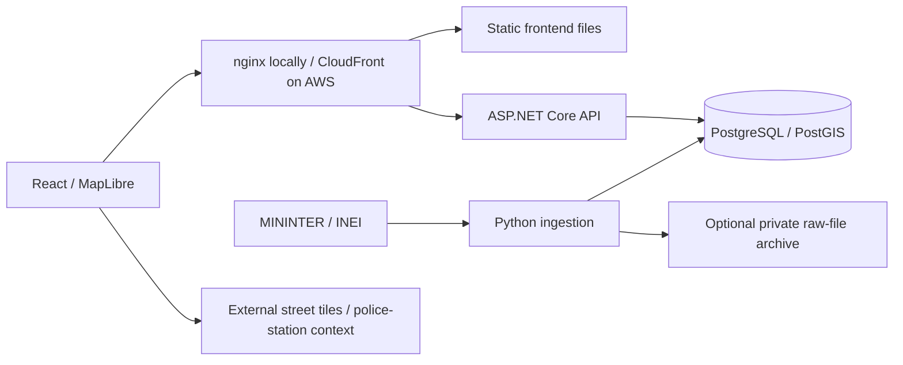
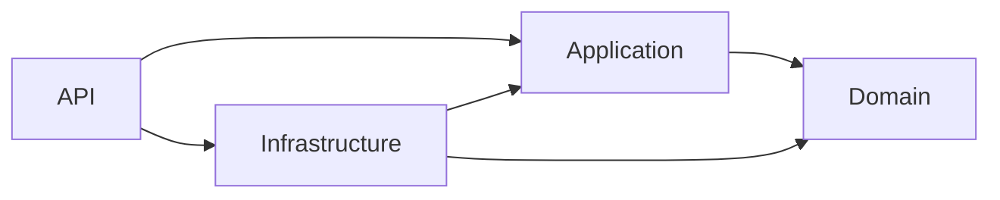

# Architecture

The application has one frontend, one read API and a separate ingestion process. PostgreSQL/PostGIS holds official aggregates, boundaries, population releases and ingestion audit records. There is no authentication, news crawler or public incident-submission service.

## Execution flow

Locally, nginx/Vite forwards `/api` to ASP.NET Core. The proposed AWS deployment replaces that proxy with CloudFront; the application use cases remain the same.

MapLibre renders the map. Contextual basemap/station providers do not change official statistical counts. Their availability and attribution are handled independently.

## Code dependencies

The arrows below mean **compile-time dependency**, not HTTP or database traffic:

Domain has no dependency on the other layers. Application owns handlers, validation, calculations, DTOs and persistence interfaces. Infrastructure implements those interfaces with EF Core/Npgsql/PostGIS. API registers implementations, binds query parameters and maps expected Result failures to ProblemDetails. A centralized exception handler and Serilog handle unexpected failures.

There is no generic repository, MediatR or additional service layer. Cancellation, bounded ranges and timeouts follow the existing use cases. CORS is browser policy, not authentication; rate limits apply per process/warm Lambda environment.

## Data ownership

| Data family | Main storage | Owner / contract |
| --- | --- | --- |
| Statistical reports and official boundaries | `monthly_reports`, district/department boundaries | Python validates/imports; .NET reads grouped counts and simplified exploration geometry |
| Geographic concentration | `concentration_*` | Separate source/year/category ingestion; public APIs return aggregates, not raw location groups |
| Population | `population_releases`, `population_observations` | Immutable releases; rates join by UBIGEO and observation year |
| Provenance and operations | `import_runs`, `ingestion_sources`, `ingestion_*` tracking tables | Audited attempts, source terms/coverage, checksums and retained observation periods |

Never combine CSV counts and geographic source rows as if they were one measure. See [methodology](methodology.md).

## Frontend and analysis

The explorer context owns shared geography and navigation. Hooks own requests, cancellation, timeouts and stale-response checks. Map and chart modules load lazily; the visited map canvas stays mounted. A coordinated initial loader waits for essential data/modules, then later updates use local loading/error states.

The sidebar owns dates for Denuncias and population analysis. Native SVG charts support counts, same-year rates, peer territories, strict rolling means, prior-only references and weighted national comparisons. History/insights responses must agree on source and observations before combined calculations are displayed. [Population contracts](ingestion/population.md) define formulas, sample requirements and three-query reads.

## Imports and schema changes

Download and validate before database mutation. Transactions, checksums, advisory locks and attempt receipts make supported imports repeatable and auditable. The [migration runner](operations.md#database-upgrades) owns ordered SQL versions. Schema upgrades are an operator/Compose step, never an API or Lambda cold-start action. Use separate migration, ingestion and read-only API database roles.

Static statistical HTML is a separate read-only export/build and may lag the live API. [Publishing](seo/publishing.md) explains periods and canonical hosts.

## AWS target

Terraform declares private S3 + CloudFront for the site, a .NET Lambda Function URL protected by CloudFront OAC, Python ingestion Lambda, EventBridge Scheduler, CloudWatch logs and externally managed Supabase Postgres/PostGIS. No VPC/NAT, load balancer or always-on application server is required by the current design.

This is a configuration target, not a claim that production exists. [AWS review](aws-review.md) records costs, limits and launch blockers; [deployment](deployment.md) describes the release procedure. [ADR 0001](adrs/0001-mvp-architecture.md) and [ADR 0002](adrs/0002-mvp-data-use-with-unresolved-authorization.md) retain the architecture and source-use decisions.

The production API connects to Supabase through **Session pooler (port 5432)** with a restricted read role, verified TLS and a maximum client pool of 2 connections per Lambda execution environment. Python ingestion retains Transaction pooler (6543); operators use direct/session connections. See the [connection templates and operational rationale](supabase-setup.md) in the Supabase runbook.
