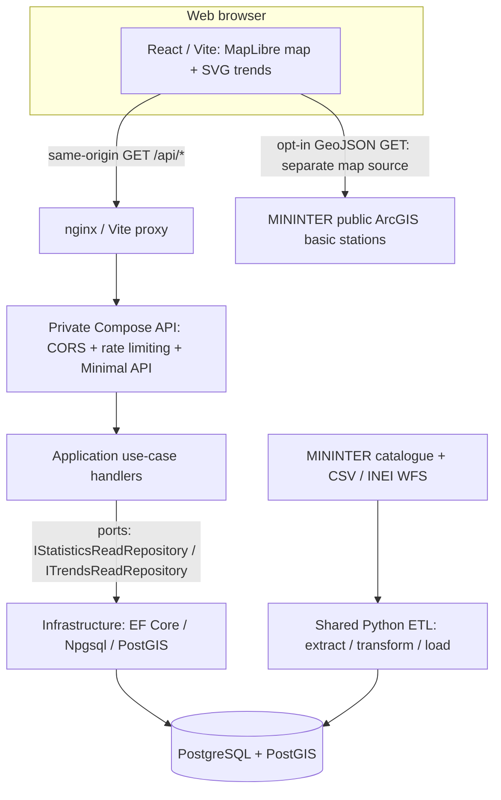
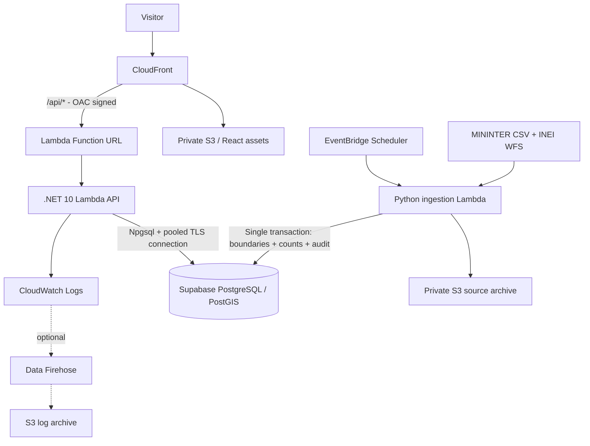

> Historical record, retained on 2026-11-13. Use the [current documentation index](../README.md) for setup and current behavior. Statements and test results below describe the date recorded, not current validation.

# Chapa Tu Choro — Architecture

## Architecture decisions

- [ADR 0001 — MVP architecture and dependencies](../adrs/0001-mvp-architecture.md).
- [ADR 0002 — Continue bounded MVP development while source-specific authorization is unresolved](../adrs/0002-mvp-data-use-with-unresolved-authorization.md). This records the maintainer's risk acceptance; it does not clear unresolved sources for public redistribution or deployment.

## Local system

## Target low-cost deployment

- Public browsers never connect directly to PostgreSQL.
- MININTER monthly report counts and sourced individual incidents are different data types.
- The same `ingestion.etl.run_etl` use case runs in local CLI/Compose and Lambda. It discovers an unambiguous official CSV link (or uses a configured pin), requests INEI WFS, validates both inputs and commits both datasets atomically. S3 is an archive output, not a manual upload prerequisite. Source changes/access failures stop the ETL explicitly.
- .NET does not invoke the Python Lambda. Both integrate independently with Supabase.
- The backend may also run as a regular Docker container; no AWS services are required locally.
- Lambda shares a small client-side connection pool. Use the Supabase transaction pooler, disable server-side prepared statements and prefer a separate restricted DB role.

See [data ingestion](../data-ingestion.md) for configuration, transaction semantics, Lambda packaging and scheduling.

## API boundaries and responsibilities

- **Domain**: report aggregate and future incident invariants; no HTTP or EF dependency.
- **Application**: explicit map/statistics/trends handlers, shared geography validation, gap/comparison rules, repository ports, source client port, Result/AppError.
- **Infrastructure**: EF Core mappings, Npgsql/PostGIS SQL, shared geography option reader, snapshot-based historical read adapter, HTTP client adapter, options validation.
- **API**: thin Minimal endpoints, global and per-client/per-route limits, concurrency limits, explicit proxy trust, HTTP error mapping, exception handler, OpenAPI, Serilog, Lambda adapter.

## Nationwide geography

The shared ETL retains all valid national report rows and district geometries, plus the official INEI department layer. `department_boundaries` supports the initial country overview; `district_boundaries` supports department-focused district queries. The explorer sums counts by the two-digit department prefix or full six-digit district UBIGEO, not textual province labels. Summary, ranking and map use one repeatable-read database snapshot. Existing installations use the additive `002_national_geography.sql` upgrade and a national reimport with an independent audit kind. See [national map](../nationwide-map.md).

## Privacy and data correctness

District total reports are not individual GPS points, individual risk estimates, or incident locations. Map choropleth colors show absolute report counts for the selected period, NOT a risk score. Display source and date prominently. Do not expose victim identities or place fabricated pins.

## Map and historical trends

The header selects Map by default. One `useStatistics` hook owns shared category/geography state, the map monthly period and a separate trends year range. A Base UI two-thumb slider keeps draft years local and commits the requested range at the end of interaction. It calls `/api/explorer` for the map and `/api/trends` for historical data, so opening trends does not download polygons. Shared selectors retain parent identity and invalidate dependent child filters. Requests use cancellation and a full filter/view/range key to prevent stale rendering. The map canvas remains mounted while hidden; trends render SVG/HTML total or multi-category lines, pie and bar charts with a shared category color mapping and themed pointer/touch/keyboard tooltips with exact-value tables, loading skeletons, empty/error/retry states and mobile layouts.

`GetTrendsHandler` validates a 1–120-month interval and geography, fills explicit null gaps for total and category timelines, and computes available totals and final-month changes. `TrendsReadRepository` obtains sparse monthly totals and monthly-category observations, category and territory aggregates, plus comparison observations and geography options, in one repeatable-read transaction. It uses the existing PostgreSQL tables, indexes and pooled Npgsql connection without changing ETL, schema or deployment topology. `GeographicFilter` and `GeographicOptionsReader` serve both map and trends to keep contracts consistent. Missing geometry never removes a report from historical aggregates.

See [trends contracts and metric semantics](../trends.md).

## Request protection

The built-in ASP.NET Core rate limiter runs for all endpoints, including health/readiness and development routes. Chained limits bound one instance, one client IP, one client/route (with a stricter trends limit), and concurrent execution. Queues are disabled. Rejections return 429 ProblemDetails, trace ID and `Retry-After`, and produce a structured warning. An explicit frontend CORS allowlist in all environments exposes the retry header to allowed origins. Limits and explicit trusted proxy addresses are validated options; arbitrary forwarded IP headers are never trusted by default.

The counters are local to one process/warm Lambda environment. They do not establish a shared quota across replicas or prevent all ingress costs. A deployment requiring a global quota needs enforcement at its trusted shared ingress. The application stays independent of that choice; no AWS or additional service is provisioned by this feature. See [limits, proxy configuration and Lambda constraints](../rate-limiting.md).

## Browser origin and backend entry-point policy

The frontend uses relative `/api` requests. Compose publishes nginx but does not publish the API container port; the native development workflow explicitly starts .NET on a loopback port and uses the Vite proxy. The CORS policy is registered after routing and before the rate limiter in all environments. Strongly typed, startup-validated `Cors:AllowedOrigins` options allow exact HTTPS origins; Development additionally allows explicit HTTP loopback origins. Production defaults to an empty allowlist, which allows the existing same-origin frontend to work without cross-origin grants. Permissions are GET/HEAD, Accept/Content-Type and exposed Retry-After, without credentials.

This is a browser read policy, not application authentication. A public site's `/api` can still be called by non-browser clients or scripts capable of forging Origin. No static frontend secret or Origin/Referer-based authentication was introduced. Terraform already declares an IAM-authenticated Lambda Function URL and CloudFront OAC permissions scoped to its distribution; these restrict direct origin invocation when deployed, but the public distribution still serves anonymous API requests. The source was inspected; no cloud state was queried or deployment applied. See [browser access and CORS](../browser-access.md).

## Official reporting guide: Denunciar

The third navigation view is a client-side curated directory. `lib/reportingResources.ts` owns typed resource metadata, short phone codes, official HTTPS destinations, scope descriptions and a source review date. `TakeAction` renders responsive semantic articles with `tel:` anchors, explicit external links and user-initiated clipboard actions. Unsupported/denied clipboard writes show a focused selectable number; a failed copy is never reported as success.

The statistics hook aborts in-flight map/trend requests and skips statistics reads while Denunciar is selected. Filters remain in the existing hook state; the sidebar and its mobile toggle are hidden for the directory, and the map canvas stays mounted while hidden. Resource access does not wait for catalogue loading, API readiness, imported data or PostGIS. No backend use case, database table, runtime scraping, extra service or CORS exception is introduced. Existing backend layering, exception handling, rate limiting and deployment architecture are unchanged.

The application neither submits reports nor collects information about a case, records call activity, or attempts to determine whether a phone call connected. Web destinations open outside the app with `noopener noreferrer`. Native telephone links hand control to the device; confirmation and call completion depend on its operating system and installed handler. Only public official references and phone numbers are bundled. See [directory scope, sources and verification](../reporting-resources.md).

Phase 1 extends this same directory with `incidentChoices` and `reportingDetails`, rather than adding backend entities or a source-registry database. `lib/navigation.ts` maps the existing view state to native History paths (`/`, `/tendencias`, `/denunciar`), handles Back/Forward and leaves modified anchor clicks native. Direct guide loads skip catalogue/statistics requests entirely. Source verification distinguishes indexed official instructions from live service availability and explicitly records uncertain anonymity/eligibility. See [assessment](../phase-0-assessment.md) and [hosting requirements](../phase-1-reporting-guide.md).

## Phase 2: independent official geographic overlay

The browser's typed `policeStations` adapter reads the publicly catalogued MININTER ArcGIS basic-station layer (REST ID 2) as paginated EPSG:4326 GeoJSON only after explicit opt-in. `usePoliceStations` owns cancellation, a 20-second timeout, retry and UBIGEO filtering; the adapter validates the complete result and keeps a successful snapshot in memory, reusable for 15 minutes, without automatic refresh of an active layer. It does not use SIDPOL year/month/category parameters. Credentials and referrer are omitted. The government's CORS policy and uptime remain external dependencies.

`CrimeMap` adds a separate point source and brown circle layer on the same MapLibre instance. Independent layer controls preserve SIDPOL contracts and totals. Station popups use text nodes, station clicks suppress underlying polygon selection, and upstream/render failures have their own messages. Container resizing refits the current official territory so expanding layer information does not crop the map. Attribution links distinguish consultation time from an undeclared source update date. No backend, schema, ETL or hosting changes are necessary; existing request protection is retained and does not regulate direct government-service traffic.

Only basic-station locations are integrated. Specific dataset licensing, accuracy and completeness remain unconfirmed; the UI and [source inventory](../official-geographic-layers.md) record those limits. Police jurisdictions are not INEI districts. No individual crime coordinates, heatmaps, news pipeline or population rates were added.

## Geographic concentration: independent aggregates

The existing Mapa view now switches exclusively between statistical choropleths and concentration. `ingestion.concentration` extracts one trusted source/month, validates period/geometry/UBIGEO and INEI containment, and persists source snapshots, district/category totals and legacy grid counts. The radius upgrade adds a server-only RLS-protected location table with validated coordinate-pair/count groups and an indexed geography point; it stores no case IDs, addresses or personal attributes. Original case rows/identifiers remain temporary; raw case files are not archived. Source authority keeps 2026 active data separate from 2025 category archives and disallows an archive-wide total.

`ConcentrationPolicy` owns grid/suppression/source rules. `GetConcentrationHandler` validates source-specific selections and geography with Result errors. `ConcentrationReadRepository` uses parameterized repeatable-read PostGIS queries and an aggregate-only SIDPOL territory/month context join. Thin `/api/concentration` routes retain ProblemDetails, Serilog and all request protection. Concentration uses the stricter heavy-query rate budget. React's dedicated hook cancels obsolete requests; the sidebar owns concentration-only selections and analytics. `CrimeMap` reuses its canvas with separate density sources and geographic outlines, suppressing choropleth fills/popups while concentration is active. No new library, service or hosting topology is introduced. See [contracts, operation and interpretation](../concentration.md).

## Street basemap and labels

The frontend `streetBasemap` adapter reads the fixed OpenFreeMap Positron style and imports only its reviewed OpenMapTiles vector source and supported visual layers, with application-specific source/layer IDs. It uses local/Spanish names where available, omits provider administrative boundaries and icon/sprite dependencies, and preserves the official INEI geometry used for filters/statistics. Surface layers sit below application fills, road lines above fills and below density, and text labels above thematic overlays with a white halo. Choropleth opacity is reduced while the basemap is ready; the neutral concentration land fill is hidden so it cannot cover roads/buildings. No `setStyle` replacement or map remount occurs.

`CrimeMap` owns the adapter lifecycle and independent loading/error/retry UI. The controller bounds initial readiness to 20 seconds, aborts stale requests and removes only its own resources when disabled, failed or unmounted. A successfully parsed style is reused in memory; disabling removes the vector source so later pans do not request its tiles. MapLibre's attribution control displays provider/OpenMapTiles/OpenStreetMap credits. The App-level **Calles y referencias** toggle defaults on, persists between map modes and suspends the basemap while other views are selected. Tile/font failures identified with this provider do not become a global statistical-map failure.

Requests go directly from the browser to the external public map provider; no credentials, API endpoints, schemas, ETL jobs, packages or AWS resources were added. Coverage and street-name currency depend on OpenStreetMap and are independent of the historical crime-report period. This contextual map does not give the aggregate crime data street-level precision. See [operation, attribution and limitations](../official-geographic-layers.md#street-basemap-and-real-road-names).

## Source locations and metric-radius analysis

Migration `004_concentration_locations.sql` adds `concentration_locations` with source/category/district/coordinate-pair multiplicities, a GiST geography index and row-level security, excluding PUBLIC and browser roles. The importer replaces these groups in the same source/month transaction as existing aggregates; a storage-version checksum triggers one-time backfill. Published heatmap positions use weighted source-location centroids rounded to 100 m, within requested 10 km / 1 km / 500 m projected bins, suppressing bins below five. Existing non-upgraded snapshots retain the previous rendering.

Application `GetRadiusAnalysisHandler` validates period, source/category, territory, finite coordinates and supported 500/1000/2000 m radii. Infrastructure `ConcentrationRadiusRepository` checks spatial availability/geography and evaluates parameterized `ST_DWithin` on indexed geography within one repeatable-read snapshot. It returns a query buffer and aggregate count; positive counts below five are suppressed while zero remains explicit. The new thin `/api/concentration/radius` endpoint retains centralized ProblemDetails/Serilog/CORS and the stricter query-rate budget. No raw point-list endpoint exists.

React `useRadiusAnalysis` owns user activation, point/radius selection, cancellation, timeout, retry and scope/import-version invalidation. `RadiusControls` explains current filters and source uncertainty. `CrimeMap` intercepts clicks only while the explicit radius tool is active, preserving ordinary geographic/station interaction otherwise, and draws the independent analytical polygon on the same canvas. Actual source precision/unique-event semantics remain undeclared; street labels do not certify event addresses and the smooth heatmap remains relative density.

## Viewport concentration detail

`GetMapCellsHandler` validates the selected source, geography, projected grid and finite Peru bounds. `ConcentrationCellsRepository` reads private location groups in a repeatable-read snapshot, expands the viewport to whole cells, suppresses groups below five and caps responses at 5,000 cells with an explicit validation error. Public centers remain rounded weighted aggregates. The thin `/api/concentration/cells` route uses the stricter query rate policy. No schema change or new service is needed.

React `useConcentrationMap` separates viewport cells from `useConcentration` territorial analytics and `useRadiusAnalysis` metric queries. Automatic resolution follows camera zoom even with national filters; a manual grid control can override it. Debounce, padded coverage reuse, cancellation and explicit loading/errors prevent stale coarse points after zoom. The legend/sidebar use the actual response grid, and camera height changes preserve zoom. Circle radii remain a separate user-selected analytical tool.

The same canvas limits navigation with MapLibre `setMaxBounds` and `setMinZoom`, derived from the initial national camera for the current canvas size. The local Mercator `cameraBounds` helper computes that framing without resetting an ongoing user zoom. Rotation, pitch and world repetition are disabled. This affects camera movement only; basemap sources and neighboring-country context remain intact. Count-symbol radius and the HTML legend share a bounded zoom curve; aggregation dimensions and distance-query semantics are unchanged.

## Separate trend publications

The existing statistical `/api/trends` contract remains unchanged. New Application `GetConcentrationTrendsHandler` and `IConcentrationTrendsReadRepository` serve `/api/concentration/trends` for one registered annual/category publication at a time. Infrastructure reads accepted-territory aggregates and import provenance in one repeatable-read snapshot; raw positions and CSV metric counts are excluded. Source availability, explicit zeros, category residuals and territorial totals retain their counting semantics. `GetTrendsHandler.Project` reuses the chart projection without combining repositories or yearly publications. The new route uses the existing stricter query budget and centralized Result/ProblemDetails/CORS/Serilog handling.

React `useGeographicTrends` owns independent year/category/month controls, metadata availability, timeouts, cancellation and stale-data protection. App shares geographic identity with the map but pauses CSV trend queries in geographic mode. The existing SVG/HTML charts accept an explicit record unit and display original-source import provenance. No migration, new ingestion step, chart package or infrastructure service is introduced.

## Phase 3: catalogue and ingestion attempts

Python owns the server-only source catalogue and execution history because extraction/load already runs in that service. SQL migration 005 adds `ingestion_sources`, `ingestion_runs` and `ingestion_run_sources`, with RLS and browser grants revoked; existing data/provenance tables are preserved. Start/stage/failure writes use separate transactions, while success receipts share the data transaction. The same tracking component covers CLI, Compose and Lambda runners. No .NET port/endpoint or frontend change is needed for this operations-only increment. Role policies and target migration application remain deployment responsibilities. See [catalogue](../sources/catalog.md) and [tracking semantics/commands](../ingestion/tracking.md).

## Searchable public HTML and statistical publishing

Vite's `seoPlugin` owns static publication alongside the React application. Shared page metadata serves the map/trends/reporting entry points and client-side navigation. Methodology and national/department statistics are lightweight HTML resources with readable tables and truthful Dataset markup; they do not load MapLibre JavaScript. Their canonical URLs, sitemap and generated CloudFront route allowlist all come from the same build. Unknown HTML paths return 404 in preview/nginx/the planned edge routing. No server rendering service or new public API endpoint is introduced.

`ingestion.export_statistics` reads only CSV aggregates, department display names and national import hashes/timestamps under one repeatable-read, read-only transaction. It atomically writes an ignored build input; static generation validates identifiers, periods and totals. Geography/classification sources and private coordinate/tracking tables remain excluded. Export/import/reporting dates are distinguished, missing periods are not zeros, and static editions can lag the live map. Publishing is separate from ingestion and requires a successful export/build/release; it is not automatically deployed by Lambda. See [SEO publishing](../seo/publishing.md) for configuration, permissions, routing artifacts and launch checks.

## Source data freshness

`ingestion.freshness` provides a private read-only source recency projection through `python -m ingestion.tracking freshness`. It derives the latest retained reporting/occurrence month per source from CSV aggregates and nonempty geographic import snapshots. Known dates, future-period errors and unknown observation dates remain distinct from import/attempt timestamps. No schema, frontend, public API, publication cadence assumption or external polling service is added. See [freshness semantics](../ingestion/freshness.md).
