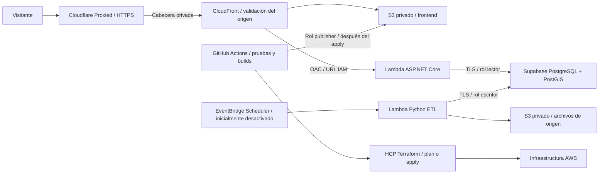

# Roadmap de setup: Supabase → AWS → HCP Terraform → GitHub → Cloudflare

Este es el recorrido completo para preparar y publicar el MVP. Los pasos de
configuración no equivalen a un despliegue. Un plan correcto tampoco verifica
permisos de escritura, conectividad de la aplicación o funcionamiento público.

**Estado de referencia:** 16 de noviembre de 2026. El operador ha configurado
Supabase, identidades, variables, certificado y reglas de Cloudflare; ha ejecutado
planes en HCP. Esta guía no afirma que el primer apply o la web pública estén
verificados. Comprueba las plataformas antes de marcar un paso como terminado.

## 1. Arquitectura y responsabilidades



| Componente | Responsabilidad | No realiza |
| --- | --- | --- |
| Supabase | Datos, PostGIS, roles y permisos | Alojar el frontend o ejecutar la API .NET |
| GitHub Actions | Pruebas, paquetes, solicitud de run y publicación estática | Ejecutar Terraform localmente en el runner |
| HCP Terraform | Estado remoto, bloqueo, ejecución de plan/apply | Compilar automáticamente los ZIP de Lambda |
| AWS | Lambda, S3, CloudFront, Scheduler y logs | Copiar por sí solo los datos de tu PostgreSQL local |
| Cloudflare | DNS autoritativo, TLS de borde y proxy con sus reglas de seguridad | Sustituir los permisos de AWS o autenticar usuarios de la API |

No se necesita un bucket S3 para el estado de Terraform: lo administra HCP.
Los buckets S3 de la aplicación sí existen. No hay RDS, NAT Gateway, ALB ni ECS.
Las alertas por correo y presupuesto automatizado se difieren fuera de este MVP.
Los créditos AWS no son un límite de gasto ni hacen gratuitos los servicios.

## 2. Antes de empezar

- Acceso al repositorio y al dominio; Cloudflare debe tener la zona activa.
- AWS CLI para diagnóstico, Docker/Compose para desarrollo e importaciones.
- Cuenta AWS del proyecto, separada de la cuenta de administración de la organización.
- Root protegido con MFA; trabajo habitual con rol federado, no root/access keys.
- Región `us-east-1`; ACM para CloudFront debe estar en esa región.
- En organizaciones con restricciones regionales, comprobar los SCP antes de ampliar IAM.
  Una denegación explícita de SCP no se resuelve adjuntando AdministratorAccess.
- Revisar límites de Supabase, crédito vigente y cuotas Lambda en la cuenta real.

No cambies producción ni ejecutes importaciones/migraciones por copiar esta guía.
Las operaciones de escritura requieren revisión del entorno y respaldo apropiado.

## 3. Preparar Supabase y los datos

La [guía de Supabase](supabase-setup.md) contiene los comandos detallados. Úsala
como procedimiento de base de datos; aquí se resume el orden y la salida esperada.

| Paso | Acción | Resultado verificable |
| --- | --- | --- |
| 3.1 | Confirmar proyecto, región, PostGIS en `extensions` y TLS | Conexión con verificación de certificado y hostname |
| 3.2 | Ejecutar `python -m ingestion.migrate` mediante el servicio migrate | Ledger con las cuatro migraciones del manifiesto |
| 3.3 | Crear cuentas `ctc_api` y `ctc_ingestion` | API lectora e ingesta escritora, sin permisos administrativos |
| 3.4 | Asignar contraseñas independientes mediante `psql \password` | Sin contraseñas en SQL, Git o historial de comandos |
| 3.5 | Verificar cuentas a través del pooler | Lecturas y permisos restringidos comprobados |
| 3.6 | Importar estadísticas SIDPOL y límites INEI | Registros, rechazos y no emparejados contabilizados |
| 3.7 | Importar concentración y población por separado | Proveniencia y períodos disponibles registrados |
| 3.8 | Comprobar catálogo, intentos, frescura y aplicación local | Datos reales consultables y ausencia de errores de acceso |

Migraciones activas: `001_baseline.sql`, `002_ingestion_leases.sql`,
`003_population.sql`, `004_database_access.sql`. El orden está en
[db/migrations.json](../db/migrations.json). No ejecutes los SQL de `db/archive`
ni vuelvas a ejecutar manualmente la baseline sobre una base existente.

**Conexiones:** operadores/migraciones usan una conexión directa o session pooler
adecuada. La API de producción usa **Session pooler (5432)**; la ingesta Python
mantiene **Transaction pooler (6543)**. Copia host, usuario y puerto del panel real.
El formato Npgsql o libpq no determina el modo de conexión. No uses la cuenta `postgres` como identidad de la aplicación.

La API requiere formato Npgsql; Python requiere URI PostgreSQL o DSN libpq. El
formato del texto no cambia el tipo de pooler. Las contraseñas de una URI requieren
codificación porcentual. No copies el formato .NET a la variable de Python.

La población procede del Excel oficial 2018–2026 suministrado por el operador.
No se descarga automáticamente con el ETL estándar. Concentración también tiene
su propio procedimiento. Ver [ingesta](data-ingestion.md) y
[población](ingestion/population.md). Si ya están importados en Supabase, desplegar
AWS no exige importarlos otra vez.

## 4. Guardar secretos de runtime en AWS SSM

En la cuenta del proyecto, región `us-east-1`, crea parámetros **Standard
SecureString** fuera de Terraform:

| Nombre | Contenido |
| --- | --- |
| `/chapa-tu-choro/prod/database-url` | Conexión Npgsql de `ctc_api` |
| `/chapa-tu-choro/prod/ingestion-database-url` | URI/DSN PostgreSQL de `ctc_ingestion` |

Ambos deben exigir TLS y verificar el servidor. Los paquetes incluyen la CA
pública en `/var/task/certs/supabase-ca.crt`; revisa [su procedencia](../certs/README.md).
En .NET configura `SSL Mode=VerifyFull`, el certificado raíz y Search Path
`public,extensions`; en Python `sslmode=verify-full` y la ruta al certificado.

Verifica nombres/tipos, sin descifrar ni imprimir valores:

```bash
aws ssm describe-parameters --region us-east-1 \
  --parameter-filters 'Key=Name,Option=BeginsWith,Values=/chapa-tu-choro/prod/' \
  --query 'Parameters[].{Name:Name,Type:Type}' --output table
```

Usa el perfil AWS apropiado si tu sesión no es la predeterminada. Terraform
referencia nombres; las Lambda recuperan los valores con sus roles separados.

## 5. Configurar dominio y certificado

1. Conecta el dominio al DNS de Cloudflare cambiando los nameservers en el
   registrador. No hace falta transferir el registro del dominio.
2. Conserva MX, SPF, DKIM y DMARC si usas correo. No reemplaces toda la zona DNS.
3. En ACM de `us-east-1`, solicita un certificado público para
   `chapatuchoro.com` y `www.chapatuchoro.com`.
4. Usa DNS validation, RSA 2048 y exportación desactivada.
5. Copia los CNAME de ACM a Cloudflare con **DNS only**. Espera a **Issued**.
6. Conserva estos CNAME para renovación. El certificado existente se referencia
   por ARN, no se vuelve a crear con Terraform.

El ARN de este entorno está en [la configuración HCP](hcp-deployment.md#existing-domain-certificate).
Tener un certificado emitido no conecta todavía la web al dominio.

## 6. Crear el workspace HCP y su identidad AWS

1. Crea organización → proyecto → workspace; para este entorno se usan `mm-dev`
   y `chapa-tu-choro-prod`. Verifica el nombre exacto del proyecto.
2. Selecciona flujo CLI/API-driven, ejecución **Cloud** (la API lo llama `remote`).
3. Configura **Terraform Working Directory = `infra/terraform`**.
4. No conectes auto-runs VCS: GitHub debe probar y compilar antes de enviar archivos.
5. En AWS IAM crea el proveedor OIDC:

   | Campo | Valor |
   | --- | --- |
   | Provider URL | `https://app.terraform.io` |
   | Audience | `aws.workload.identity` |

6. Crea `chapa-tu-choro-prod-terraform`: Web identity → proveedor anterior →
   Workload Type **Workspace Run**. Limita organización, proyecto y workspace a
   sus valores exactos; Run Phase `*` permite plan/apply usando `StringLike`.
   Revisa la confianza: su `sub` debe seguir
   `organization:ORG:project:PROJECT:workspace:WORKSPACE:run_phase:*` y comprobar `aud`.
7. Adjunta como inline [la política HCP](../infra/iam/hcp-deployment-policy.json).
   No la reutilices para GitHub. Actualízala cuando cambien los permisos del repo.

### Variables HCP

**Categoría Terraform:** strings sin HCL ni comillas; booleanos con HCL activado.

| Nombre | Valor del entorno | HCL | Sensitive |
| --- | --- | --- | --- |
| `environment` | `prod` | No | No |
| `aws_region` | `us-east-1` | No | No |
| `database_ssm_parameter_name` | `/chapa-tu-choro/prod/database-url` | No | No |
| `ingestion_database_ssm_parameter_name` | `/chapa-tu-choro/prod/ingestion-database-url` | No | No |
| `site_domain` | `chapatuchoro.com` | No | No |
| `site_certificate_arn` | ARN del certificado emitido | No | No |
| `enable_cloudflare_proxy` | `true` | Sí | No |
| `cloudflare_origin_token` | Secreto de origen generado en el paso 8 | No | Sí |
| `enable_ingestion_schedule` | `false` | Sí | No |
| `enable_log_archive` | `false` | Sí | No |
| `sidpol_source_url` | URL CSV oficial revisada | No | No |

La URL usada para la importación actual es:

```text
https://www.datosabiertos.gob.pe/sites/default/files/DATASET_Denuncias%20Policiales%20-%20Enero%202018%20a%20Septiembre%202026.csv
```

Es un release fijado, no una promesa de actualización automática a futuros meses.
La disponibilidad del proveedor puede cambiar. El descubrimiento vacío falló por
varios candidatos en este setup; no se debe seleccionar un archivo arbitrariamente.

**Categoría Environment:**

| Nombre | Valor |
| --- | --- |
| `TFC_AWS_PROVIDER_AUTH` | `true` |
| `TFC_AWS_RUN_ROLE_ARN` | ARN del rol `chapa-tu-choro-prod-terraform` |

Estas últimas no son variables Terraform. No añadas access keys permanentes.

## 7. Conectar GitHub con HCP y AWS

### 7.1 Entorno y token HCP

- Configura `main` como rama predeterminada y protégela con PR y comprobaciones CI.
- Crea **Settings → Environments → `production`**.
- En Deployment branches selecciona explícitamente `main`. “Protected branches
  only” sin ramas protegidas no constituye esa restricción.
- Agrega revisor si tu plan lo permite. Si trabajas solo, no actives Prevent
  self-review. El botón “Approve and deploy” autoriza el job; su efecto depende
  de si es un run manual de plan o un push de despliegue.
- Crea un token HCP de equipo limitado si está disponible o de usuario con el
  menor acceso necesario. No uses Organization token para este flujo.
- Guarda el token únicamente como **Environment secret `HCP_TOKEN`**. El token
  de usuario hereda los permisos de su usuario; define caducidad y rotación.

### 7.2 Identidad AWS del publisher

Crea otro proveedor OIDC con URL `https://token.actions.githubusercontent.com`
y audiencia `sts.amazonaws.com`. Crea el rol `chapa-tu-choro-prod-publisher` con
confianza limitada al repositorio y al environment `production`.

Para este repositorio, los identificadores públicos verificados son owner
`174894619` y repo `1452215074`; el formato de sujeto utilizado es:

```text
repo:mau-mic@174894619/chapa-tu-choro@1452215074:environment:production
```

Confirma el formato real de GitHub si cambias de repositorio o personalizas OIDC.
No uses el sujeto por rama cuando el job utiliza environment. Consulta
[OIDC de GitHub](https://docs.github.com/en/actions/how-tos/secure-your-work/security-harden-deployments/oidc-in-aws).

El publisher necesita ListBucket/GetBucketLocation sobre el bucket `site`,
PutObject/AbortMultipartUpload sobre sus objetos y CreateInvalidation/GetInvalidation
sobre la distribución. No necesita leer SSM, crear infraestructura ni borrar datos.
Tras el primer apply, limita su ARN de distribución al ID concreto. El rol HCP
administra infraestructura; el publisher publica archivos: son roles distintos.

### 7.3 Variables GitHub

**Environment `production` → Variables:**

| Nombre | Valor |
| --- | --- |
| `HCP_ORGANIZATION` | `mm-dev` |
| `HCP_WORKSPACE` | `chapa-tu-choro-prod` |
| `AWS_PUBLISH_ROLE_ARN` | ARN del publisher |
| `SITE_URL` | `https://chapatuchoro.com` |
| `SEO_NOINDEX` | `true` hasta verificar la web |

**Repositorio → Settings → Secrets and variables → Actions → Variables:**

```text
ENABLE_AUTO_DEPLOY=false
```

Esta variable es de **repositorio**, no de environment: se evalúa antes de entrar
al entorno de producción. Ausente o distinta de `true` desactiva el deploy por push.
`SITE_URL` de GitHub no sustituye a `site_domain` de HCP.

## 8. Preparar la protección Cloudflare

1. Genera un secreto aleatorio: `openssl rand -hex 32`. Guárdalo en un gestor de
   contraseñas, no en Git, chat o capturas. No es un API token de Cloudflare.
2. Ponlo en la variable HCP Sensitive `cloudflare_origin_token`.
3. En Cloudflare → Rules → Transform Rules → Modify Request Header, crea una
   regla para `http.host in {"chapatuchoro.com" "www.chapatuchoro.com"}`.
4. Usa **Set static**, header `X-Ctc-Origin-Token`, valor igual al de HCP. Set debe
   sobrescribir valores suministrados por visitantes, no agregarlos.
5. Mantén CF-Connecting-IP activo y Pseudo IPv4 desactivado o Add Header; no uses
   Overwrite Headers. Revisa Workers si modifican identidad del visitante.
6. Configura SSL/TLS **Full (strict)** y comprueba el certificado Edge de Cloudflare.
7. Prepara una Cache Rule de bypass para `/api` y `/api/*`. No apliques Cache
   Everything a HTML. Permite caché de assets con nombre versionado.
8. Espera al apply para apuntar los registros web: aún no existe el hostname de
   CloudFront cuando solo has ejecutado un plan.

CloudFront verifica la prueba, elimina la cabecera privada y sobrescribe la IP
verificada del visitante para la API. El backend valida esa IP antes del limiter.
Esto no convierte la API en privada para los usuarios ni impide todos los bots.
Los límites siguen siendo por instancia Lambda. No hay AWS WAF de pago en el stack.

El secreto reside en el estado HCP y en el código de la función edge. Sensitive
oculta el output normal, no impide que un lector autorizado de estado/código lo
obtenga. Restringe accesos y rota HCP/Cloudflare coordinadamente. No desactives la
protección para diagnosticar DNS ni pruebes el token en comandos que queden en logs.

## 9. Publicar código y ejecutar solo el plan

1. Valida los cambios, crea commits de funcionalidad y un PR hacia `main`.
2. Mantén `ENABLE_AUTO_DEPLOY=false` durante ese merge. CI corre; deploy queda Skipped.
3. En **Actions → CI → Run workflow**, selecciona `main`, modo `plan`.
4. Espera pruebas y aprueba el environment si lo solicita.
5. GitHub compila ZIPs/frontend y envía una copia limitada de Terraform y artefactos
   a HCP. No se envían datos, tfvars locales ni el repositorio entero.
6. HCP crea un run `plan-only=true`, `auto-apply=false`. El enlace aparece en el log.
7. Revisa additions/changes/deletions, región, roles, certificado, dominios y schedule
   desactivado. “Planned and finished” no significa “Applied”.

Ese run de revisión no publica S3 ni ejecuta invalidaciones y no se promueve a
apply con este workflow. Un fallo de plan no crea los recursos de la aplicación.
Los eventos `apply_start` de lectura de data sources en el log JSON no son un apply.

## 10. Primer despliegue real

1. Tras revisar y autorizar el plan, cambia **ENABLE_AUTO_DEPLOY=true**.
2. Integra un nuevo commit revisado a `main`. Cambiar la variable por sí solo no
   dispara el workflow. Un PR de documentación también dispara deploy si se integra
   con la variable en true. No hace falta crear commits vacíos para revisar planes.
3. Aprueba `production`: en un run por push, esta aprobación **sí autoriza apply**.
4. HCP calcula un plan nuevo y aplica. Revisa el run hasta `Applied`.
5. GitHub publica assets antes de HTML, conserva assets anteriores e invalida
   CloudFront. No se migran bases ni importan datos como parte del deploy.

El hostname aparece tras crear la distribución: AWS → CloudFront → Distributions →
**Distribution domain name**, o HCP → Outputs → `cloudfront_url` (quita `https://`
al usarlo en DNS). CloudFront es global; cambiar la región no crea distribuciones.

### Conectar DNS mientras termina el primer lanzamiento

En Cloudflare reemplaza solo los registros web en conflicto:

| Tipo | Nombre | Target | Proxy |
| --- | --- | --- | --- |
| CNAME | `@` | `dXXXXXXXX.cloudfront.net` real | Proxied |
| CNAME | `www` | El mismo hostname real | Proxied |
| CNAME | Validación ACM | Valor original de ACM | DNS only |

No pongas una URL con `https://` o rutas en el Target. Elimina A/AAAA web obsoletos
para esos mismos nombres cuando corresponda; conserva correo y validación.

El pipeline comprueba `SITE_URL`. En el primer despliegue puede fallar esa
comprobación mientras conectas DNS, aunque el apply haya terminado. Completa DNS,
verifica el dominio y revisa el run antes de reintentar. No presupongas rollback.
Si cambias configuración/credenciales de GitHub, un nuevo run toma la configuración
actual. Si corriges código, ejecuta sobre el nuevo commit, no el SHA fallido anterior.

## 11. Verificación y apertura de indexación

```bash
curl -I https://chapatuchoro.com/
curl -I https://www.chapatuchoro.com/tendencias
curl --fail https://chapatuchoro.com/api/health
curl --fail https://chapatuchoro.com/api/ready
```

- `www` redirige a apex conservando ruta/query; HTTPS válido en ambos tramos.
- Mapa, filtros, tendencias, tasas, concentración y Denunciar funcionan en móvil y escritorio.
- `/api/ready` confirma conexión real y permisos de base, no solo proceso encendido.
- Respuestas normales llevan las cabeceras; inspecciona respuestas edge/errores aparte.
- La CSP detallada sigue Report-Only: revisa consola, no declares XSS completamente resuelto.
- CloudFront directo devuelve 403 sin prueba, incluso intentando usar el Host público.
- Lambda Function URL directa queda bloqueada por IAM/OAC; S3 permanece privado.
- API no cacheada; workers `.mjs` con MIME JavaScript; rutas desconocidas devuelven 404.
- Prueba 429 e independencia de visitantes sin enviar tráfico abusivo o exponer IPs.
- Verifica que no quedan contraseñas/tokens en logs y comprueba cuotas/consumo real.

Tras verificar, cambia `SEO_NOINDEX=false` y publica un nuevo build mediante el
flujo revisado. Revisa sitemap/canonical y [SEO publishing](seo/publishing.md).
Cambiar variables no recompila archivos ya publicados. No habilites ingesta
programada hasta validar una ejecución manual y su auditoría de datos.

## 12. Operación, fallos y límites

| Síntoma | Comprobar |
| --- | --- |
| Deploy Skipped tras merge | ENABLE_AUTO_DEPLOY de repositorio; es esperado si está en false |
| No existe Run workflow | workflow_dispatch publicado en la rama predeterminada; permisos Actions |
| HCP sin runs | Job esperando aprobación o fallando antes de subir configuración |
| Exit 1 sin enlace HCP | Modo remote y working directory exacto `infra/terraform` |
| Precondition con site_domain vacío | Categoría Terraform en HCP; no confundir con SITE_URL |
| AccessDenied al aplicar | Rol HCP, acción y recurso exactos; política inline actualizada y SCP |
| No hay distribución | Solo hubo plan, apply falló o estás en otra cuenta |
| Dominio da 403 | Proxy, Transform Rule Set, secreto coincidente, Host e IP de visitante |
| Cloudflare 525/526 | Certificados/aliases/despliegue y Full (strict); no bajar a Flexible |
| Aplicación carga pero API falla | SSM, credenciales de rol, CA/pooler, permisos DB, verified IP y 429 |
| Health check falla tras Applied | DNS/propagación o problema runtime; recursos no se revierten solos |
| Timeout de GitHub | El run de HCP puede seguir activo; inspección antes de reintentar |
| Favicon viejo tras deploy | Caché del navegador/Cloudflare; invalidar CloudFront no purga Cloudflare |

No ejecutes escritores concurrentes del mismo workspace mientras publica GitHub.
No uses `terraform apply` local sobre el entorno HCP ni `terraform destroy` como
rollback. Una aplicación fallida puede dejar recursos parcialmente creados; vuelve
a planificar con el mismo estado. El rollback de código no revierte de forma
segura todas las migraciones o cambios de infraestructura. Conserva releases y
respalda datos por separado. Los archivos estáticos retirados requieren limpieza
revisada; el sync actual no borra assets antiguos.

## 13. Fuentes y referencias

- [HCP dynamic AWS credentials](https://developer.hashicorp.com/terraform/cloud-docs/dynamic-provider-credentials/aws-configuration)
- [GitHub OIDC y sujetos inmutables](https://docs.github.com/en/actions/how-tos/secure-your-work/security-harden-deployments/oidc-in-aws)
- [Certificados CloudFront](https://docs.aws.amazon.com/AmazonCloudFront/latest/DeveloperGuide/cnames-and-https-requirements.html)
- [ACM DNS validation](https://docs.aws.amazon.com/acm/latest/userguide/dns-validation.html)
- [Cloudflare Full (strict)](https://developers.cloudflare.com/ssl/origin-configuration/ssl-modes/full-strict/)
- [Transform Rules](https://developers.cloudflare.com/rules/transform/request-header-modification/)
- [Cloudflare caching](https://developers.cloudflare.com/cache/concepts/default-cache-behavior/)
- [Contratos y detalles de HCP](hcp-deployment.md), [Supabase](supabase-setup.md), [operación local](operations.md), [pruebas](testing.md)
